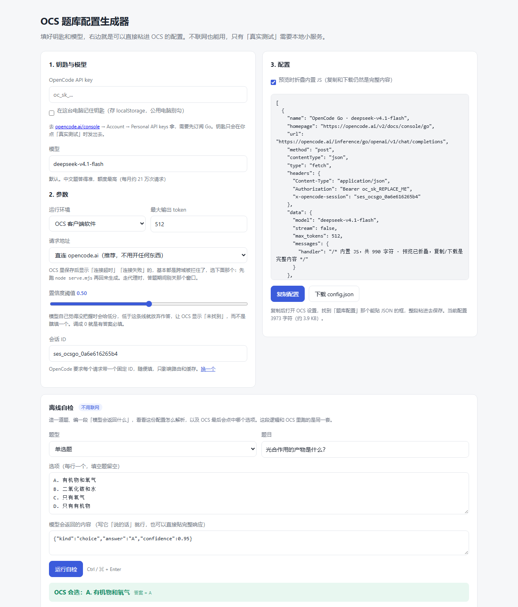

# 让 OCS 遇到不会的题时去问 AI

OCS 本来是从题库网站查答案的。这个项目给它换了个「题库」——一个 AI。

每遇到一道题，它把题目和选项一起发给 OpenCode 的模型，模型回一个答案，再翻成 OCS 能点的那种格式。就这样，不用买题库、不用到处找接口。

**用起来大概是什么感觉：** 常规题基本 2 秒出一道，选择题、判断题、填空题都能答。模型没把握的题会空着不动，留给你自己答——不会瞎填一个错的上去。

> 本文只讲怎么用。它是怎么实现的、为什么要这么写，放在最后一段。

---

## 三步用上

### 第一步：拿一把钥匙（API key）

1. 打开 <https://opencode.ai/console>，登录
2. 订阅 **Go**（每月 $10 那个，不是按量付费的余额）
3. 进 **Account → Personal API keys → Add API key**，起个名字，创建
4. 复制那串 `oc_sk_...` —— **只显示这一次**，关掉就没了

### 第二步：把钥匙填进去

在这个目录下打开 PowerShell：

```powershell
$env:OC_API_KEY = "oc_sk_你刚才复制的"
node build.mjs
```

跑完会多出一个 `config.local.json`，里面就是配好钥匙、可以直接用的配置。

> 为什么多一个文件？因为带真钥匙的那份不能传到 GitHub 上。`config.json` 是给仓库看的（钥匙位置写着占位符），`config.local.json` 是给你自己用的，已经被 `.gitignore` 挡在门外。

### 第三步：贴进 OCS

打开 `config.local.json`，**全选、复制**（连开头的 `[` 和结尾的 `]` 一起）。

去 OCS 的设置里找到填「题库配置」的地方 —— 一个能贴 JSON 的输入框，把内容整个粘进去，保存。

然后随便找份课，点开始答题，看会不会自动填。

---

## 不想敲命令？用网页点一点

双击 `web/index.html` 就能用：填钥匙、选模型、拉一下「置信度阈值」，右边实时出配置，点「复制配置」再粘进 OCS。全程不联网，钥匙也不会离开你的电脑。



想确认模型到底通不通，在目录里跑：

```powershell
node serve.mjs
```

然后打开 <http://127.0.0.1:8787>，页面底部会多出一个「真实测试」按钮 —— 拿上面那道题真的问一次模型，几秒后告诉你答案、耗时和 HTTP 状态。

> 为什么要起个服务：opencode.ai 那边没开跨域，浏览器里直接请求会被拦下来，得有个本地的东西替页面去发。这个服务只监听 127.0.0.1，除了转发请求什么都不做。

页面上还有一块**离线自检**：随便造一道题、编一段「模型会回什么」，就能看到这道配置会怎么解析、OCS 最后会点中哪个选项。不用联网，不用钥匙，调提示词的时候很好用。

---

## 花多少钱？会限流吗？

Go 是**包月**的，$10 一个月，额度按「美元」折算到每个模型上。默认用的 DeepSeek V4.1 Flash 每月额度 $100 等值，官方估算是**每月 21 万次请求**左右。一门课 200 题，你自己算算就知道离用完还有多远。

实际花钱要看你答多少题，但按这个量级，正常上课是花不完的。

---

## 出问题了怎么查

OCS 上每一道题都显示「未找到答案」的时候，先别急着改配置，去软件里打开控制台看日志（搜「开发者工具」或者按 F12，找 Console 面板）。配置里所有报错都会以 `[OCS/OpenCode]` 开头打在那里。

对着日志里的话看：

| 日志里写着 | 意思 | 怎么办 |
|---|---|---|
| `Invalid credential` | 钥匙不对 | 回第一步重新复制一遍，注意别少了字符 |
| `403` | 这个模型你的套餐不带，或者根本没订阅 | 换成下面表格里的模型试试 |
| `MissingSessionID` | 配置被改坏了，少了一行请求头 | 重新跑 `node build.mjs` 生成一份新的 |
| 一直转圈然后超时 | 模型太慢 | 换更快的模型（见下表） |
| `Failed to fetch` | 网络连不上 OpenCode | 检查网络或代理；如果是浏览器版 OCS，改用客户端软件 |
| 题库列表里显示**连接超时** / **连接失败** | 请求根本没发出去，基本是跨域被拦了 | 用「本地代理」模式，见下一条 |

**一点「测试」就显示连接超时？** 大概率不是你网络的问题，是 OCS 自己也跨不过去 —— 跟你浏览器里打不开一样的原因。两条路，选一条：

- 网页版里把「请求地址」切成**走本地代理**，先 `node serve.mjs`（答题期间别关它），再把新生成的配置粘进 OCS；
- 或者命令行 `node build.mjs --proxy`，用生成的 `config.local.json`。

代理只是把你电脑上的请求转一手，钥匙还是写在你自己那份配置里，不经过任何第三方。

还有一条很好用的排查办法：直接跑一下

```powershell
node test/live.mjs
```

它会真的发一次请求，把「状态码、耗时、模型原话」全打出来。通了说明配置没问题，不通说明是钥匙或网络的事。

---

## 想换个模型

改 `build.mjs` 里那行 `model`，重跑 `node build.mjs`，重新贴一次就换好了。

| 写这个 | 什么感觉 |
|---|---|
| `deepseek-v4.1-flash` | 默认值。中文题答得挺准，额度也最高 |
| `glm-5.3-flash` | 更快、更稳，中文也不错，额度少一些但够用 |
| `gpt-6-luna` | 最快最便宜的一档 |
| `mimo-v2.6-flash` / `longcat-2.0` | 额度大、响应快 |
| `glm-5.3` / `qwen3.8-flash` | 更强一点，但慢一些 |

换完想验一下快不快，跑：

```powershell
node test/live-matrix.mjs
```

它会拿 8 道不同类型的题挨个问一遍，把每道题的耗时和答出来的答案列成一张表。

---

## 几句实话

- **它不是百分百准。** 常识题、文科题很稳；专业计算题、教材特有的说法容易错。建议先找一门不重要的课跑一遍，看看准确率再决定要不要放开。
- **每道题都会真发一次请求**，没有缓存。同一道题被问两次，就花两次钱。
- **Go 套餐本来是给写代码的 AI 用的**，官方文档里明说了有滥用监控。拿它当答题器不是它的设计用途，被限流了别怪我没提醒你。真要长期跑，按量付费的模型反而更省心。
- **钥匙就是钱。** 别截图发群里，别贴进公开仓库。

---

## 想改代码才看这一段

真正在干活的是两个函数，都在 `src/` 里，用大白话写就行，不用懂 OCS 源码：

- `src/handler.messages.js` —— **把题目变成问题**。决定 AI 看到什么、怎么被要求作答。想让它答得保守一点、或者语气不一样，改这里。
- `src/handler.response.js` —— **把 AI 的话变成答案**。负责拆 JSON、纠正大小写、判断题换成选项原文、没把握就丢掉。开头的 `MIN_CONFIDENCE = 0.5` 就是「多没把握才放弃」的分数线，调高更保守，调成 0 就变成有答案必填。

改完这两份**必须重跑** `node build.mjs` —— 因为 OCS 要的是「一个字符串里包着一段 JS」，手写 JSON 转义百分百出错，让脚本帮你拼。

然后跑 `node test/validate.mjs` 自检（38 项，不用联网，几秒钟跑完）。它会模拟各种题型，并且用从 OCS 源码搬来的匹配算法验证「我们吐出去的答案，OCS 真的会点中那个选项」——不是只检查 JSON 格式对不对。

文件都在哪：

```
config.json          ← 仓库里这份，钥匙是占位符
config.local.json    ← 你本地这份，带真钥匙（不进 git）
build.mjs            ← 拼配置的脚本（顺手生成 web/ 里的两个文件）
src/                 ← 两个 handler 的源码，改这里
test/                ← 自检、联网冒烟、8 种题型矩阵
web/                 ← 网页版：生成器 + 离线自检 + 真实测试
serve.mjs            ← 网页版的本地小服务（只为绕开跨域）
```

网页用的配置结构和匹配算法都是 `build.mjs` 从 `src/`、`test/` 里生成的，不是另抄了一份，所以改完源码重跑 `node build.mjs`，网页也会跟着更新。

还有一个前提条件值得知道：OCS 等回复的上限是 **60 秒**，超时就当这题没搜到。这个数写在 OCS 源码里，题库配置改不了。所以别选那种要思考半天的模型。
